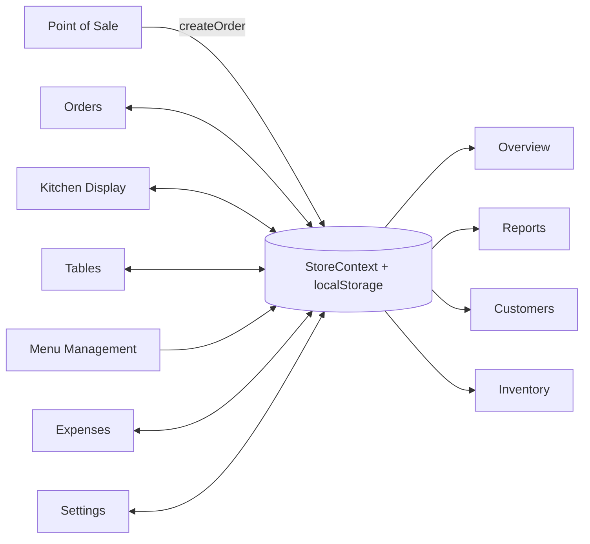
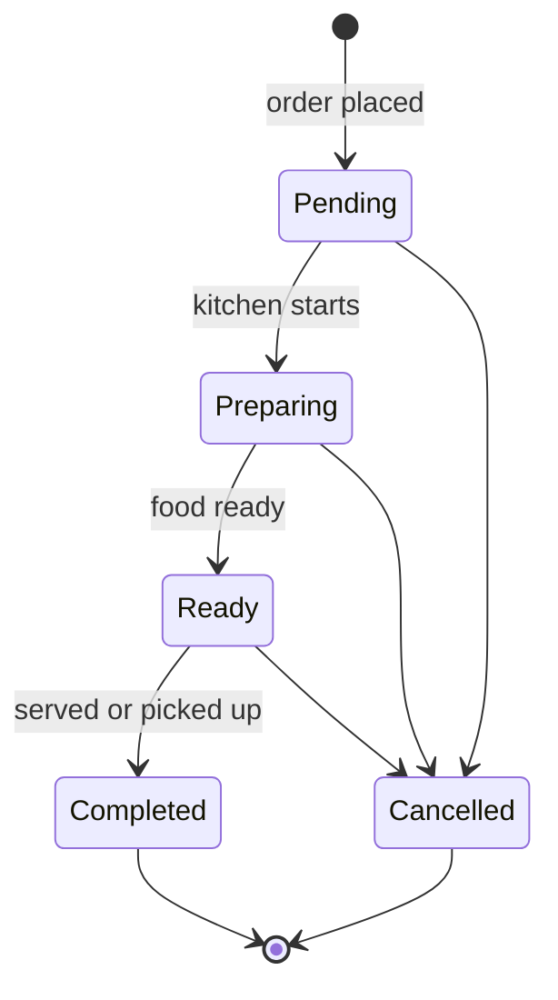
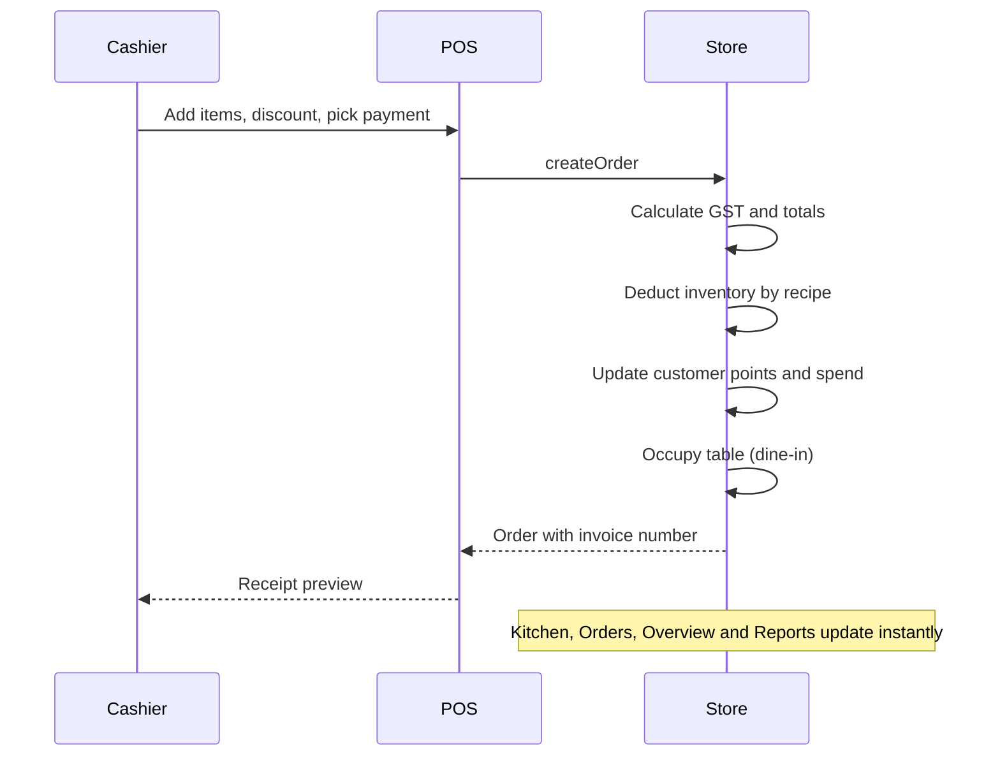

# CafeOS

**Smart Cafe Operations.** A modern cafe POS and restaurant management dashboard for "The Coffee House", inspired by Petpooja but built as a cleaner, faster SaaS-style interface.

This is a frontend-only demo. All data is mock data held in React state and saved to localStorage, so there is no backend, database or real payment integration.

## Demo video

Watch the walkthrough: https://www.loom.com/share/6fbfbc501cc34e828c8318401eda3b8a

## Highlights

- Cashier-first POS with variants, add-ons, discounts, coupons and cash, UPI, card or split payment
- Live kitchen display with timers and Pending, Preparing, Ready, Completed workflow
- Visual floor plan with seat, reserve, transfer and merge actions
- GST-aware billing with CGST and SGST breakdown and printable invoices
- Inventory that auto-deducts stock from recipes when orders are placed
- Reports with date ranges, charts and CSV export
- Light and dark themes, responsive for desktop, tablet and mobile

## Screens

| Screen | What you can do |
| --- | --- |
| Overview | Revenue, orders, AOV, tables and pending KPIs, 7-day trend, best sellers, live kitchen |
| Point of Sale | Browse and search the menu, build a cart, discount, charge, preview the receipt |
| Orders | Filter, search, update status, view invoice, reprint, cancel with confirmation |
| Tables | Seat guests, assign orders, transfer, merge, reserve, create and delete tables |
| Kitchen Display | Move order cards through the workflow with time-based urgency, full-screen mode |
| Menu Management | Products, categories, variants, add-ons, GST rate, image upload, availability |
| Inventory | Stock, purchase entries, suppliers, wastage, movement history, low-stock alerts |
| Customers | Profiles, order history, loyalty points and tiers |
| Staff | Roles, account status, sales per employee, activity log |
| Reports | Sales, payments, categories, hourly sales, tax, discounts and refunds, CSV and PDF export |
| Expenses | Categorised expenses with filters, payment method and notes |
| Settings | Business profile, billing and GST, printers, orders, permissions, notifications, system |

## How it fits together

All screens read from and write to one shared store, so an action in one place shows up everywhere.



### Order lifecycle



### What happens at checkout



## Tech stack

| Area | Choice |
| --- | --- |
| Framework | React 19 with hooks, Vite |
| Styling | Tailwind CSS v4 with the Northern Lights theme (tweakcn) in `src/index.css` |
| Routing | React Router |
| Charts | Recharts |
| Icons | Lucide React |
| State | React context with localStorage persistence |

## Getting started

Requires Node.js 18 or newer.

```bash
npm install
npm run dev       # start the dev server
npm run build     # production build into dist/
npm run preview   # serve the production build
```

## Project structure

```
src/
  components/
    layout/    Sidebar, Header, DashboardLayout, help dialog
    common/    Button, Modal, Drawer, DataTable, forms, badges, toasts, dropdowns
    charts/    Recharts wrappers
    orders/    Receipt, checkout modal, order drawer
    pos/       Item customizer, customer picker, discount modal
  pages/       One file per screen
  context/     StoreContext: shared state and all actions
  data/        mockData: menu, orders, customers, inventory, staff, expenses
  hooks/       Small shared hooks
  utils/       calculations (GST and totals), analytics, formatters
public/menu/   Menu photos
```

## Billing and GST

- Menu prices are GST-exclusive by default. Turn on "Menu prices include GST" in Settings, Billing and GST to extract tax from the listed price instead.
- Discounts (percent or flat) are applied before tax and spread across line items.
- Tax is split into CGST and SGST, and the total is rounded to the nearest rupee.

## Demo data

- Today's orders, tables, stock levels and staff are generated on first load, with timestamps relative to the current time.
- Data resets automatically each new day. To reset manually, go to Settings, System Preferences, Reset demo data.
- Clearing the browser's site data also resets everything.

## Notes

- Menu items without a photo show a category icon tile. Upload your own image from Menu Management.
- PDF export uses the browser print dialog. Choose "Save as PDF".
- Multi-outlet switching is a placeholder in this demo.
